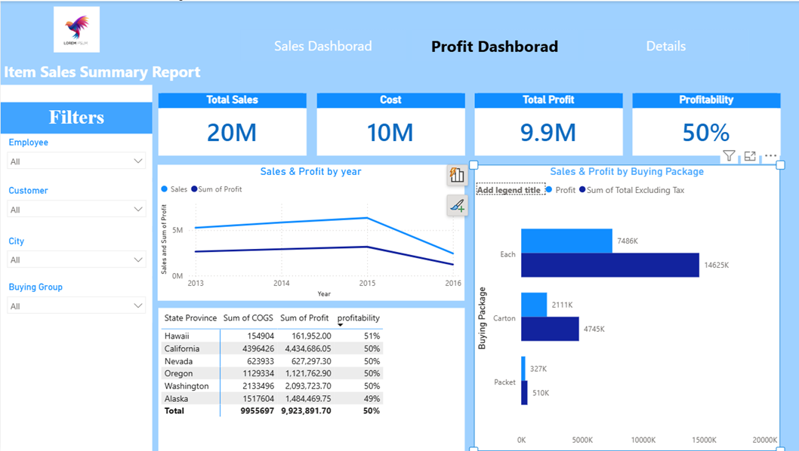

# Power BI Sales & Profitability Analysis

An interactive business intelligence project built with Microsoft Power BI to analyze sales performance, profitability, and business trends through data modeling, data transformation, and interactive reporting.

## 📌 Project Overview

This project transforms sales data into an interactive Power BI report designed to help business stakeholders explore sales performance and profitability from different perspectives.

The project includes dedicated report views for overall performance, sales analysis, and profitability, enabling users to move from a high-level overview to more focused business analysis.

## 🎯 Business Objectives

- Analyze overall sales performance and identify important trends.
- Evaluate profitability to better understand business performance.
- Explore sales data across different business dimensions.
- Organize data from multiple source tables into a model suitable for reporting.
- Present business metrics through interactive and easy-to-understand visualizations.

## 🛠️ Tools & Technologies

- **Microsoft Power BI Desktop** — Report development and data visualization.
- **Power Query** — Data cleaning and transformation.
- **DAX** — Calculated measures and analytical calculations.
- **Data Modeling** — Organizing relationships between data tables.
- **Microsoft Excel** — Supporting data source for the project.

## 🔍 Project Workflow

### 1. Data Preparation
Prepared the source data for analysis using Power Query, with a focus on creating a consistent structure for reporting.

### 2. Data Modeling
Organized the available sales, customer, date, city, employee, and product-related data into a reporting model.

### 3. Analytical Calculations
Used DAX to support calculations and performance analysis within the Power BI report.

### 4. Report Development
Designed interactive report views to present sales performance and profitability in a visual format.

### 5. Business Analysis
Structured the report to help users explore performance trends, compare business dimensions, and investigate profitability.

## 📊 Dashboard Pages

### 1. Sales Analysis
Focuses on exploring sales performance through dedicated analytical visualizations.

### 2. Profitability Analysis
Provides a dedicated view for examining business profitability and supporting further performance analysis.

## 💼 Business Value

The report provides a consolidated analytical view that can support business users in:

- Monitoring sales performance.
- Exploring patterns across business dimensions.
- Investigating profitability.
- Identifying areas that may require further analysis.
- Supporting data-driven discussions and business decisions.

## 📁 Repository Contents

| File / Folder | Description |
|---|---|
| `Sales project.pbix` | Power BI report and analytical model |
| `FactSale (source).csv` | Sales transaction data |
| `DimCity (source).csv` | City-related data |
| `DimCustomer (source).csv` | Customer-related data |
| `DimDate (source).csv` | Date-related data |
| `DimEmployee (source).xlsx` | Employee-related data |
| `DimStockItem (source).csv` | Product and stock-item data |
| `Overview.png` | Overview report screenshot |
| `Sales Anaysis.png` | Sales analysis screenshot |
| `profitability.png` | Profitability report screenshot |

## 🚀 How to Explore the Project

1. Clone or download this repository.
2. Open `Sales project.pbix` using Microsoft Power BI Desktop.
3. Review the report pages and visualizations.
4. Interact with the available filters and slicers to explore the data.
5. Review the data model and calculations to understand the analytical approach.

*Note: If the report prompts for data sources, update the source paths to match the downloaded repository location.*

## 🧠 Skills Demonstrated

- Data cleaning and transformation with Power Query.
- Data modeling for business intelligence.
- DAX-based calculations and analysis.
- Interactive report and dashboard development.
- Sales and profitability analysis.
- Business-focused data visualization.
- Translating structured data into analytical reporting.

---

**Project Category:** Data Analytics & Business Intelligence  
**Primary Tool:** Microsoft Power BI  
**Technologies:** Power Query | DAX | Data Modeling | Excel
